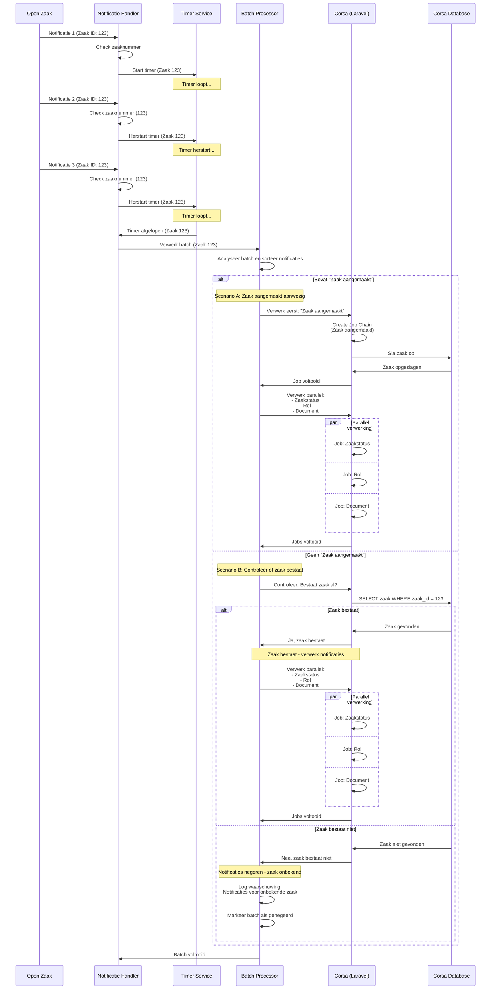
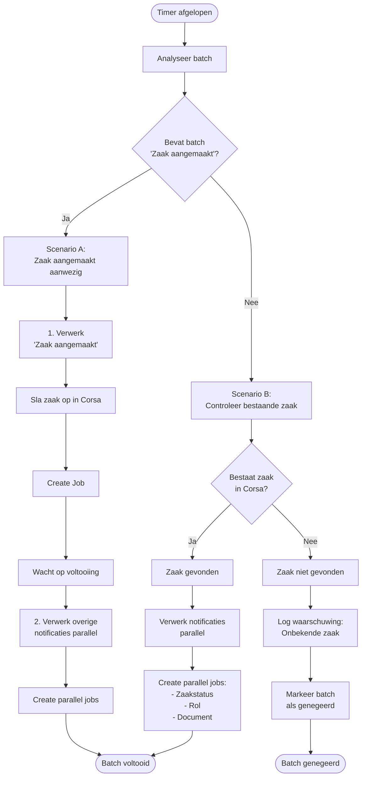

# Verwerking notificaties open zaak naar Corsa

## Admin-overzicht

Het paneel toont datums en tijden in de tijdzone Europe/Amsterdam; in de database staan ze in UTC (`app.timezone`), dat verandert niet.

Het Filament admin-paneel biedt een read-only overzicht van alle ontvangen batches en notificaties via `/admin/batches` (sectie "Monitoring"). Batches zijn doorzoekbaar op `zaak_identificatie` en filterbaar op status. Per batch zijn de bijbehorende notificaties zichtbaar in verwerkingsvolgorde (create:zaak eerst, create:resultaat laatst), inclusief tijdstempel van verwerking en de volledige JSON-payload per notificatie.

Genegeerde notificaties (zie "Acties en genegeerde notificaties" hieronder) komen niet in een batch en staan daarom in een eigen read-only overzicht, "Genegeerde notificaties" via `/admin/ignored-notifications` (ook sectie "Monitoring"). Daar staan per notificatie het moment van negeren, de zaak (leeg als die niet is opgehaald), de reden, het kanaal, de actie en de resource, nieuwste eerst. Het overzicht is doorzoekbaar op zaak, filterbaar op reden en zaak, en te groeperen per zaak met het aantal per groep. Per notificatie toont "Bekijk payload" de opgeslagen gegevens, inclusief `kenmerken`, en het moment van ontvangst als dat afwijkt van het moment van negeren (alleen bij een notificatie die al in een batch zat). Heeft de zaak van een batch genegeerde notificaties, dan linkt de batchpagina naar dat overzicht, gefilterd op die zaak. Het overzicht wijzigt niets: opnieuw verwerken, bewerken of verwijderen kan er niet.

Notificaties op de directe route (zie "Directe route voor documenten in bewerking" en "Documentwijzigingen" hieronder) komen ook niet in een batch. Daarom is er het read-only overzicht "Notificaties" via `/admin/notifications` (sectie "Monitoring"). Daarin staan alle notificaties die niet genegeerd zijn, nieuwste eerst, met de zaak, de route (Batch of Direct), het type (een documentwijziging staat er als `update:enkelvoudiginformatieobject` of `partial_update:enkelvoudiginformatieobject`), de status (Verwerkt, Mislukt of Nog niet verwerkt) en een link naar de batch als die er is. Het moment van verwerken staat in "Bekijk payload" en is als kolom aan te zetten via de kolomkeuze; standaard staat die kolom uit, zodat de acties ook op een laptopscherm in beeld blijven. Het overzicht is doorzoekbaar op zaak en filterbaar op route, status en zaak. "Bekijk payload" toont de opgeslagen gegevens, en bij een mislukte notificatie ook de fout. Is van een mislukte notificatie het id van de mislukte job bekend, dan staat er een link naar die job in Horizon (in het overzicht, in "Bekijk payload" en bij de notificaties van een batch); die opent in een nieuw tabblad. Horizon bewaart mislukte jobs een beperkte tijd (`horizon.trim.failed`, standaard een week); daarna werkt de link niet meer, maar de foutomschrijving blijft bij de notificatie staan. De notificaties op de batchpagina tonen dezelfde status en hebben dezelfde "Bekijk payload". Ook dit overzicht wijzigt niets.

## Volgordelijkheid van berichten
Omdat notificaties in onvoorspelbare volgorde binnenkomen, én verwerking tijd kost, moeten notificaties (soms) in een specifieke volgorde worden verwerkt.
Daarnaast is het zo dat onvoorspelbaar is welke notificaties binnenkomen en binnen moeten zijn voor een taak gestart kan worden. Daarom verwerken we
notificaties als volgt:
- Bij elke notificatie die binnenkomt checken we het zaaknummer
- Voor elk zaaknummer starten we bij een binnengekomen notificatie een timer
- Als een nieuwe notificatie binnenkomt voor die zaak terwijl de timer loopt herstarten we de timer
- Als de timer afloopt starten we verwerking van de notificaties, op een logische volgorde

Voor het bepalen van de volgorde hanteren we de volgende types notificaties die we verwerken (op kanaal `zaken` met actie `create`, tenzij anders vermeld):
- Zaak aangemaakt (`zaak`), altijd als eerste
- Zaakstatus aan zaak toegevoegd (`status`)
- Document aan zaak toegevoegd (`zaakinformatieobject`)
- Document gewijzigd (kanaal `documenten`, `update` of `partial_update` op `enkelvoudiginformatieobject`), na de overige en vóór het resultaat
- Resultaat aan zaak toegevoegd (`resultaat`), altijd als laatste

Binnen elk van die groepen houdt de batch de volgorde van ontvangst aan. Een documentwijziging komt normaal niet in een batch (zie "Documentwijzigingen"), alleen als terugval.

Een rol die aan een zaak wordt toegevoegd wordt niet verwerkt; zo'n notificatie wordt als genegeerd opgeslagen (zie hieronder).

De 'zaak aangemaakt' notificatie moet altijd als eerste worden verwerkt. Andere notificaties kunnen daarna parallel worden verwerkt. Als in een 
notificatiebatch (gedefinieerd als de set notificaties die binnen een timer-periode binnen zijn) géén zaak aangemaakt zit kunnen de notificaties parallel
worden verwerkt, anders moet eerst de 'zaak aangemaakt'-notificatie worden afgehandeld.

## Acties en genegeerde notificaties
Het endpoint neemt elke actie aan die de ZGW API's publiceren: `create`, `update`, `partial_update` (een PATCH) en `destroy`. Kanaal en resource zijn vrij. Een andere actie, of een link die niet op een geconfigureerde ZGW-host staat, geeft een 422. De optionele `kenmerken` uit het bericht worden met de notificatie opgeslagen.

Een notificatie die wel wordt aangenomen maar niet verwerkt, krijgt een 200 en wordt opgeslagen als genegeerd: `ignored_at` is gezet, `processed` blijft `false` en de notificatie komt niet in een batch. De reden staat in `ignored_reason`:
- `unsupported_channel`: het kanaal is niet `zaken` of `documenten`. De zaak wordt niet opgehaald.
- `unsupported_action`: de combinatie van actie en resource wordt niet verwerkt, bijvoorbeeld `update:zaak`, `destroy:zaak` of `create:rol`. De zaak wordt niet opgehaald, omdat die na een `destroy` niet meer bestaat.
- `unknown_zaaktype`: het zaaktype van de zaak heeft geen mapping.
- `inactive_zaaktype`: het zaaktype van de zaak heeft een mapping die niet actief is.
- `document_not_linked`: een gewijzigd document hangt aan geen enkele zaak. Wordt het later gekoppeld, dan neemt de koppeling de nieuwste versie mee.
- `document_in_multiple_zaken`: een gewijzigd document hangt aan meer dan één zaak met een actieve mapping. Daarbij komt een waarschuwing in het log.

Op kanaal `documenten` valt ook een `create` of `destroy` van een document onder `unsupported_action` (een nieuw document gaat via de koppeling aan een zaak naar Corsa; verwijderen wordt nog niet verwerkt), net als alles op `gebruiksrechten` en `verzending`.

Bij `unknown_zaaktype` en `inactive_zaaktype` is het zaaknummer bekend en opgeslagen (bij een documentwijziging alleen als het document aan precies één zaak hangt). Omdat de volledige notificatie bewaard blijft, kan die later alsnog verwerkt worden, bijvoorbeeld nadat de mapping is geactiveerd. Dat opnieuw verwerken is nog niet gebouwd.

Komt een niet ondersteunde combinatie toch in een batch terecht (een notificatie van vóór deze controle), dan markeert de verwerking die als genegeerd met reden `unsupported_action`. De job faalt dan niet, zodat de rest van de batch doorloopt.

## Directe route voor documenten in bewerking
Elke notificatie heeft een route: `batch` (standaard) of `direct`.

Een `create:zaakinformatieobject` waarvan het gekoppelde document de status `in_bewerking` heeft, wacht niet op de batch van de zaak. Bij binnenkomst haalt de applicatie de koppeling en het document op om de status te lezen. Bij elke andere status, of als het document niet op te halen is, gaat de notificatie zoals altijd de batch in. Een notificatie op de directe route komt niet in een batch; de job `ProcessDocumentDirectly` verwerkt hem op de queue `direct`:
- Staat de zaak al in Corsa, dan gaat het document er meteen in.
- Staat de zaak nog niet in Corsa, dan gaat de notificatie de batch van de zaak in (de route wordt `batch`). De batch maakt eerst de zaak aan.
- Een verbindingsfout, time-out (408), 429 of serverfout bij het ophalen uit de ZGW API's of bij het toevoegen van het document aan Corsa wordt opnieuw geprobeerd na 30 seconden, 2 minuten en 5 minuten. Elke andere fout laat de job meteen mislukken. Een mislukte job is zichtbaar in Horizon en de notificatie krijgt de status Mislukt (zie "Mislukte notificaties").
- Een fout bij de controle of de zaak in Corsa staat, telt als "zaak niet in Corsa": de notificatie gaat zonder herhaling de batch in.

Elk document dat naar Corsa gaat, via welke route ook, komt in de tabel `document_syncs`: de URL van het document, de zaak, de identificatie die naar Corsa ging, de `versie` en of er een placeholder is gestuurd. Staat een document daar al voor dezelfde zaak, dan wordt het niet nog eens gestuurd. Zo voegt een notificatie die twee keer binnenkomt het document niet twee keer toe. De controle, het versturen en de registratie lopen onder een cache-lock per document-URL, dus dat geldt ook als twee jobs voor hetzelfde document tegelijk lopen (een herhaalde aflevering, of de directe route en de batchroute). De lock duurt hooguit 300 seconden, de job-time-out in productie. Een job die de lock niet krijgt, probeert het 15 seconden later opnieuw en vindt het document dan in het register. Dat telt niet als fout: de directe job mislukt nog steeds bij de vierde tijdelijke fout, de batchjob bij de eerste fout. Wat de lock niet dekt: een time-out bij het versturen terwijl Corsa het document wel opsloeg; een herhaalpoging stuurt het dan opnieuw.

Een document met status `in_bewerking` zonder inhoud (geen `inhoud`, of een lege download) en zonder `bestandsdelen` gaat als klein tekstbestand met de tekst "Tijdelijk bestand" naar Corsa. Dat geldt op beide routes, dus ook voor zo'n document dat in een batch terechtkomt. Elk ander document zonder inhoud blijft geweigerd. De eerste documentwijziging met echte inhoud vervangt de placeholder (zie hieronder).

## Documentwijzigingen
Een `update` of `partial_update` op `enkelvoudiginformatieobject` (kanaal `documenten`) gaat altijd via de directe route. Het hoofdobject is het document zelf. Bij binnenkomst zoekt de applicatie de zaak via `GET {zaken}/zaakinformatieobjecten?informatieobject=<document>` en telt alleen zaken met een actieve zaaktype-mapping:
- geen koppeling: genegeerd met reden `document_not_linked`;
- koppelingen, maar geen zaak met een actieve mapping: genegeerd met `unknown_zaaktype` of `inactive_zaaktype` (met het zaaknummer als er precies één zaak is);
- precies één zaak met een actieve mapping: opgeslagen op de directe route voor die zaak, job `ProcessDocumentDirectly` op de queue `direct`;
- meer dan één: genegeerd met reden `document_in_multiple_zaken` en een waarschuwing.

De job haalt altijd de nieuwste versie van het document op en:
- slaat over als `document_syncs` die `versie` of een nieuwere al heeft (zo is een dubbele aflevering onschadelijk);
- wacht als `bestandsdelen` niet leeg is (de upload is nog niet compleet);
- kijkt of het document in Corsa staat: eerst in `document_syncs`; heeft dat geen regel (bijvoorbeeld een document van vóór het register), dan in de lijst van documenten van de zaak in Corsa (`geefLijstZaakdocumenten`), op de identificatie van het document;
- stuurt het met `updateZaakDocument`, altijd met de inhoud uit de Documenten API en dezelfde gegevens als bij het toevoegen, en werkt het register bij (`versie`, `placeholder` uit).

Staat het document nog niet in Corsa of is de upload nog niet compleet, dan kijkt de job na 30 seconden, 2 minuten en 5 minuten opnieuw. Staat het document er daarna nog niet, dan gaat de wijziging naar de batch van de zaak, waar de koppeling die het document toevoegt eerst komt; ontbreekt het document daar nog steeds, dan mislukt de job zichtbaar. Is de upload na de laatste keer nog niet compleet, dan mislukt de job. Wachten telt niet als fout. Een wijziging zonder inhoud terwijl het document nog `in_bewerking` is, wordt overgeslagen en de placeholder blijft; zonder inhoud bij een andere status mislukt de job. Een wijziging gebruikt dezelfde lock per document als het toevoegen.

De lijst van documenten uit Corsa lezen we als het zaakobject met per document een `heeftRelevant` en daaronder de identificatie bij `gerelateerde`. Die vorm is nog niet bevestigd op een testomgeving van Corsa. Geeft Corsa op de vraag om de lijst een foutmelding, of een antwoord zonder zaakobject, dan telt het document als niet in Corsa (een HTTP- of verbindingsfout gaat zoals elke andere fout van de job), zodat de wijziging in de batch zichtbaar mislukt in plaats van onder een verkeerde identificatie te worden verstuurd.

## Mislukte notificaties
Mislukt de job die een notificatie verwerkt definitief (na de laatste poging, of meteen bij een blijvende fout), dan krijgt de notificatie `failed_at`, een korte foutomschrijving (`failure`) en het id van de mislukte job (`failed_job_id`, het uuid van de job, dat Horizon ook gebruikt voor zijn pagina `/horizon/failed/{id}`). Bij een HTTP-fout bevat de omschrijving alleen de status, omdat de melding anders (een deel van) de response bevat, en bij een databasefout alleen de SQLSTATE, omdat de melding anders verbindingsgegevens en de query bevat; andere meldingen worden ingekort, met lange nummers en e-mailadressen gemaskeerd. Wordt de notificatie later alsnog verwerkt, bijvoorbeeld na opnieuw proberen vanuit Horizon, dan worden deze velden weer leeg. Een directe notificatie die alsnog naar de batch gaat, verliest de mislukking ook.

Een batch staat op `processing` zolang zijn keten loopt. De laatste job van de keten (`MarkBatchProcessed`) zet de batch op `processed`; die draait pas als alle jobs ervoor klaar zijn, ook na een job die op de lock wachtte en opnieuw werd ingepland. Een batch zonder notificaties staat meteen op `processed`. In een batchketen draaien de jobs na een mislukte job niet, ook de laatste niet. Zo'n batch blijft `processing`, de mislukte notificatie staat op "Mislukt" en de notificaties erna blijven "Nog niet verwerkt".

Het batchoverzicht en de batchpagina tonen welke batches niet helemaal goed zijn gegaan, afgeleid uit de notificaties. "Mislukt" (rood) geeft het aantal notificaties in de batch met een definitief mislukte job, en staat er alleen als dat er minstens één is. "Niet alles verwerkt" (oranje) staat bij een batch met status `processed` waarin een notificatie niet verwerkt, niet mislukt en niet genegeerd is. Omdat een batch pas na zijn hele keten op `processed` komt, hoort dat niet voor te komen; het signaal zegt niet wat de oorzaak is. Een lopende batch ("processing") is blauw, zodat die niet met het oranje signaal verward wordt. Het overzicht is op beide te filteren ("Met mislukte notificaties" en "Onvolledig").

## Afhandeling
Van elke batch wordt een 'job chain' gedefinieerd in de applicatie (Laravel). 

## Flowchart

## Batchingmechanisme met timer

```mermaid
gantt
    title Timer Reset bij Notificaties - Meerdere Zaken
    dateFormat ss
    axisFormat %S sec
    
    section Zaak 123 - Notificaties
    Notificatie 1 ontvangen    :milestone, n1_123, 00, 0s
    Notificatie 2 ontvangen    :milestone, n2_123, 03, 0s
    Notificatie 3 ontvangen    :milestone, n3_123, 07, 0s
    Notificatie 4 ontvangen    :milestone, n4_123, 17, 0s
    
    section Zaak 123 - Timer
    Timer Zaak 123 (5 sec)     :t1_123, 00, 5s
    Timer Zaak 123 reset       :t2_123, 03, 5s
    Timer Zaak 123 reset       :t3_123, 07, 5s
    Timer Zaak 123 (5 sec)       :t3_123, 17, 5s
    
    section Zaak 123 - Verwerking
    Batch verwerking start     :milestone, process_123, 12, 0s
    Batch verwerking Zaak 123  :active, p_123, 12, 6s
    Batch verwerking start     :milestone, process_123, 22, 0s
    Batch verwerking Zaak 123  :active, p_123, 22, 6s
    
    section Zaak 456 - Notificaties
    Notificatie 1 ontvangen    :milestone, n1_456, 13, 0s
    Notificatie 2 ontvangen    :milestone, n2_456, 15, 0s
    Notificatie 3 ontvangen    :milestone, n3_456, 17, 0s
    Notificatie 4 ontvangen    :milestone, n4_456, 20, 0s
    
    section Zaak 456 - Timer
    Timer Zaak 456 (5 sec)     :t1_456, 13, 5s
    Timer Zaak 456 reset       :t2_456, 15, 5s
    Timer Zaak 456 reset       :t3_456, 17, 5s
    Timer Zaak 456 reset       :t4_456, 20, 5s
    
    section Zaak 456 - Verwerking
    Batch verwerking start     :milestone, process_456, 25, 0s
    Batch verwerking Zaak 456  :active, p_456, 25, 3s
    
    section Zaak 789 - Notificaties
    Notificatie 1 ontvangen    :milestone, n1_789, 14, 0s
    
    section Zaak 789 - Timer
    Timer Zaak 789 (5 sec)     :t1_789, 14, 5s
    
    section Zaak 789 - Verwerking
    Batch verwerking start     :milestone, process_789, 19, 0s
    Batch verwerking Zaak 789  :active, p_789, 19, 2s
```

